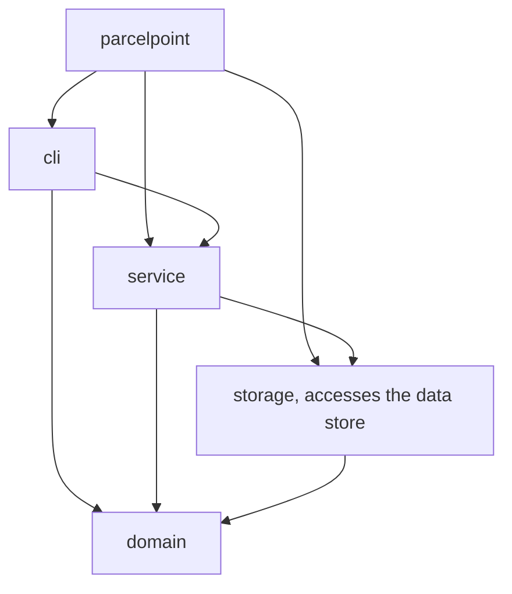
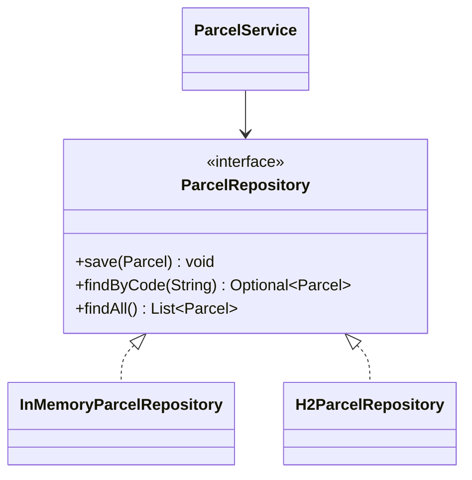
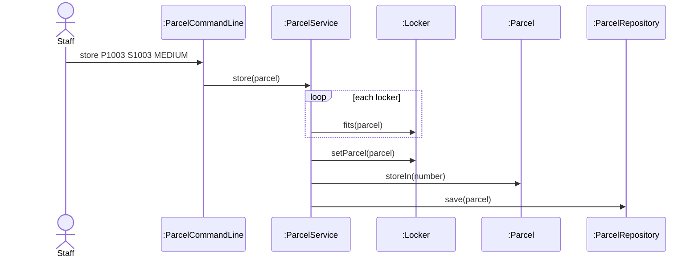

# Lab Report, Designing the Data Management Layer with H2

Repository URL: https://github.com/kjmcha/itcs382-h2-lab

## Tools

| Item | Version or name |
| --- | --- |
| JDK | OpenJDK 25.0.5 (Temurin)|
| Maven | Apache Maven 3.10.0 |
| IDE | Visual Studio Code 1.146.0 |
| AI tool and exact model, if you used one | Google Gemini | 

## Part 0. From a store in memory to H2

Commit of the starter, before any change: 5c4ab43 

0.3 Your prediction for `staff`, written before the second run: The staff command will show no stored parcels and report that all 3 lockers are free (Free lockers: 3).

Output of the second run, for `staff` and `quit`:

```text
> staff
  Free lockers: 3
  > quit
```

State in one sentence where you think the parcels of the first run were kept.
The parcels from the first run were kept in the program's memory (RAM) inside a LinkedHashMap, which was freed when the program ended.

0.5 The line of Main that you would change to keep the parcels somewhere else:

```java
  ParcelRepository repository = new InMemoryParcelRepository();
```

0.6 Commit of the switch to H2: 004858b

0.7 Output of `SELECT * FROM PARCEL;` after you stored two parcels:

```text
CODE  | STUDENT_ID | PARCEL_SIZE | STATUS | LOCKER_NUMBER
P1001 | S1001      | SMALL       | STORED | 1
P1002 | S1002      | LARGE       | STORED | 3
(2 rows, 19 ms)
```

0.8 Explain why ParcelPoint could not start while the H2 Shell was open, and identify the class that wrote the message `Cannot create the PARCEL table`.
ParcelPoint could not start because H2 is an embedded database that locks the database file (parcelpoint.mv.db) for exclusive use by one process at a time, and the H2 Shell still held it open. The class H2ParcelRepository wrote the first line of the error message (Cannot create the PARCEL table).

0.9 Explain why `staff` shows no parcel while `find` shows each one, and why all three lockers look free.
The staff command shows no parcels because findAll() in H2ParcelRepository has not been implemented yet and currently returns an empty list, whereas find calls findByCode() which already reads from the database. All three lockers look free because ParcelService's constructor relies on findAll() to reload waiting parcels back into their lockers when the program starts.

0.11 Your findAll method:

```java
    @Override
public List<Parcel> findAll() {
    String sql = "SELECT * FROM PARCEL ORDER BY CODE";
    List<Parcel> parcels = new ArrayList<>();
    try (Connection connection = connect();
         PreparedStatement statement = connection.prepareStatement(sql);
         ResultSet row = statement.executeQuery()) {
        while (row.next()) {
            parcels.add(toParcel(row));
        }
    } catch (SQLException e) {
        throw new IllegalStateException("Cannot read the parcels", e);
    }
    return parcels;
}
```

Commit that adds findAll: fc22b19

0.12 Output of `SELECT * FROM PARCEL;` after the pickup:

```text
CODE  | STUDENT_ID | PARCEL_SIZE | STATUS    | LOCKER_NUMBER
P1001 | S1001      | SMALL       | PICKED_UP | null
P1002 | S1002      | LARGE       | STORED    | 3
(2 rows, 20 ms)
```

0.13 Optional. Describe what `find P9999'OR'1'='1` showed while the SQL was joined from strings, and what it showed after you put the placeholder back.

## Part A. Model the design

A1 Complete the flowchart with one node for each package and one arrow for each dependency, from the package that uses to the package that is used. Mark the package that accesses the data store.



State whether cli depends on storage, and explain why.
No, cli does not depend on storage. ParcelCommandLine only imports classes from service and domain, delegating all data operations to ParcelService rather than accessing the repository layer directly.

A2 Complete the class diagram of the data management layer with ParcelService, the interface ParcelRepository with its three operations, and the two classes that implement it.



A3 Draw a sequence diagram for the command `store P1003 S1003 MEDIUM`, from the staff member to the repository. Show each message as an operation of the class that receives it.



Explain why the last lifeline is the interface ParcelRepository rather than H2ParcelRepository.
The last lifeline is the interface ParcelRepository because ParcelService only depends on the ParcelRepository abstraction and does not know which concrete repository class (such as H2ParcelRepository or InMemoryParcelRepository) is injected at runtime.

## Part B. Design questions

1. Identify the files that you changed to move from the store in memory to H2, and explain why no other class had to change. Use the terms of this course.
Only Main.java was changed to switch from the in-memory store to H2. No other class had to change because the system isolates the data management layer behind the ParcelRepository interface, following the Dependency Inversion Principle. ParcelService depends strictly on this interface abstraction, while Main serves as the single composition root that injects the concrete H2ParcelRepository implementation.

2. The PARCEL table stores the size of a parcel as SMALL, MEDIUM or LARGE rather than as 1, 2 or 3. Identify the type of connascence between ParcelSize and the table in each case, and explain which one is weaker.
Storing the parcel size as SMALL, MEDIUM, or LARGE creates connascence of name, because both ParcelSize and the PARCEL table must agree on the exact constant names parsed by ParcelSize.valueOf(). Storing 1, 2, or 3 creates connascence of position (or convention), because both sides must agree on the numeric order or code assigned to each size. Connascence of name is weaker because reordering or adding enum constants will not silently break the mapping of existing database records.

3. Project Phase 2 asks for a data store that needs no separate server. Explain why an embedded database such as H2 meets this rule, and describe the limit of an embedded database that Step 0.8 showed.
An embedded database such as H2 meets the requirement because it runs inside the Java application process as a library and stores data in a local file, requiring no separate database server to install or run. However, Step 0.8 demonstrated its key limitation: H2 locks the database file for exclusive access by a single process, preventing two programs (such as ParcelPoint and the H2 Shell) from accessing the database concurrently.

4. State the data store that you would choose for your Project Phase 2 team, files or an embedded database, the requirement that drives the choice, and the package that will access it.
For our Project Phase 2 team, we would choose an embedded H2 database rather than plain files. This choice is driven by the requirement to persist structured records across program runs and query or update specific entries reliably using SQL without setting up a separate server. The data store will be accessed exclusively by our data management package behind repository interfaces.

## AI usage declaration

| AI tool and exact model | Date | Purpose | Files or answers it produced or changed | How you checked its output |
| --- | --- | --- | --- | --- |
| Google Gemini | 14 November 2026 | Explain lab instructions, verify environment setup, review findAll() implementation, and draft report answers | H2ParcelRepository.java, LAB_REPORT.md | Compiled and ran the program with Maven and H2 Shell to verify outputs, rendered Mermaid diagrams on mermaid.live, and checked all explanations against the Java source code |
